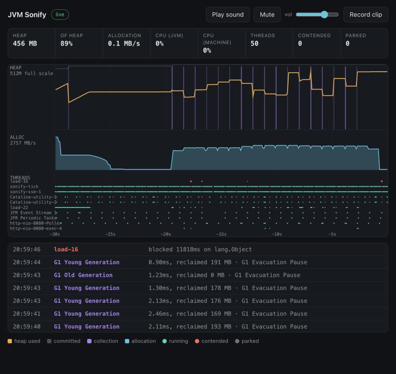

# JVM Sonify

**Hear your Spring Boot app run.** Add one dependency, set one property, open one URL — and your
JVM becomes a multi-parameter patient monitor. Heap is a drone that rises as memory fills. Every
garbage collection is a kick drum. Allocation sets the hi-hat tempo. Lock contention arrives as a
detuned, dissonant cluster, and a long pause trips a broadband alarm.

A healthy application sounds like a calm heartbeat with a melody over it. A struggling one sounds
tense — and because each vital owns its own timbre, you can tell *which* one went wrong with your
eyes shut.



Nothing like this exists as a library. `flight-recorder-starter` exposes JFR through Actuator, but
it is record, download, flamegraph. A 2020 tersesystems post sonified GC through MXBeans as a
one-off experiment. This is live JFR streaming, browser visuals and Web Audio, as a zero-code
Spring Boot starter.

---

## Quick start

**1. Add the starter**

```xml
<dependency>
  <groupId>net.bitsar</groupId>
  <artifactId>sonify-spring-boot-starter</artifactId>
  <version>0.1.0-SNAPSHOT</version>
</dependency>
```

**2. Turn it on**

```properties
sonify.enabled=true
```

**3. Open it**

```
http://localhost:8080/sonify/
```

Press **Play sound** — browsers require a gesture before any audio can start. No code changes, no
annotations, no wiring. Without `sonify.enabled=true` the starter is completely inert: no beans,
no endpoints, no threads, nothing measured.

---

## Documentation

| Document | What it covers |
| --- | --- |
| **[FINDINGS.md](docs/FINDINGS.md)** | **Start here to learn.** Sixteen things measured on this project that contradicted a safe-looking assumption, with the numbers. |
| [ARCHITECTURE.md](docs/ARCHITECTURE.md) | How a collection becomes a kick drum. Every class, and why it is there. |
| [SCENARIOS.md](docs/SCENARIOS.md) | The sixteen production pathologies: what each is, what to watch, what to listen for. |
| [SOUND-DESIGN.md](docs/SOUND-DESIGN.md) | The audio engine, the register map, and the four decisions that matter more than the mapping. |

Module guides: [core](sonify-core/README.md) · [autoconfigure](sonify-spring-boot-autoconfigure/README.md) ·
[starter](sonify-spring-boot-starter/README.md) · [scenarios](sonify-scenarios/README.md) ·
[demo](sonify-demo/README.md) · [reactive demo](sonify-demo-reactive/README.md)

---

## Try the demo

```bash
mvn -q -DskipTests package
java -Xmx512m -jar sonify-demo/target/sonify-demo-0.1.0-SNAPSHOT.jar
```

Open <http://localhost:8080/sonify/>, press **Play sound**, then:

```bash
curl "localhost:8080/load/alloc?mb=400"
curl "localhost:8080/load/lock?threads=16&ms=50"
curl "localhost:8080/load/leak?mb=150"
curl "localhost:8080/load/calm"
```

`sonify-demo/scripts/story.sh` runs the whole sequence — calm, allocation spike, contention
storm, leak, recovery — with narration. Press **Record clip** first and you have a reel.

For the sixteen real scenarios against PostgreSQL, Redis and a third-party API, see
**[SCENARIOS.md](docs/SCENARIOS.md)**.

---

## How it works

```
JFR RecordingStream          platform MXBeans
  GarbageCollection            heap used / committed / max
  GCHeapSummary                CPU, process and machine
  JavaMonitorEnter             thread count, BLOCKED, WAITING
  ThreadPark                   allocation, total and per-thread
  SocketRead
       └──────────┬──────────────────┘
                  ▼
        aggregator + 100ms tick
                  ▼
      bounded ring buffer per client   (drop oldest, never blocks)
                  ▼
          SSE  {base-path}/stream      MVC: SseEmitter · WebFlux: Flux
                  ▼
     browser: Canvas 2D + Web Audio + MediaRecorder
```

The recording stream starts on the **first** subscriber (about 13ms) and stops a grace period
after the last one leaves. One stream serves every connected browser.

### Why some readings come from MXBeans and not JFR

JFR is used only for what nothing else can see. Everything measurable exactly is read from the
platform MXBeans, which behave identically across operating systems. Three measurements drove
that split:

| Finding | Consequence |
| --- | --- |
| `jdk.CPULoad` reports **0.000** for the JVM on macOS while the machine is at 50% | CPU comes from `OperatingSystemMXBean`, which reported a correct 0.497 |
| `jdk.ObjectAllocationSample` summed **55% low** against a known 125 MiB | Allocation comes from the thread bean, which was within **0.1%** |
| JFR reports a wait only when it **ends**, so a stuck thread emits nothing | Thread states are read instantaneously; a connection leak went from 5 reported to 65 |

That last one is the most important idea in the project. A drained pool or a client with no read
timeout emits no events at all while every thread sits stuck, so an event-driven monitor shows an
idle application. Full detail in [FINDINGS.md](docs/FINDINGS.md).

A useful consequence: if Flight Recorder is unavailable, heap, CPU, threads and allocation keep
working. Sonify logs one warning and runs with fewer vitals rather than failing.

**Latency.** JFR flushes in batches of up to a second and that is not tunable (measured: median
~0.5s, max ~1s). Collections and contention reach the browser up to a second after they happen.
They are drawn and sounded at their *own* timestamps, so the timeline stays truthful. Heap, CPU,
threads and allocation have no such delay.

---

## The sound

| Vital | Sound | Register |
| --- | --- | --- |
| Heap used % | continuous sine drone, 90→260 Hz | low, a bed under everything |
| CPU load | tremolo and filter **on the drone** | shapes it, adds no voice |
| Threads stuck | breath pad, filtered noise swelling | low-mid, the sound of waiting |
| Allocation rate | hi-hat tempo, log-scaled | high and short |
| GC pause | kick, sine sweep 140→40 Hz | sub-bass — the heartbeat |
| Long GC (>100ms) | broadband noise burst | alarm, cuts through |
| Lock contention | detuned square, pitch per thread | mid, deliberately dissonant |
| Live threads | pentatonic notes | mid-high, pleasant when healthy |
| Heap not recovering | slow dissonant swell | a collection that reclaimed nothing |

A **What you are hearing** panel above the timeline gives each voice a meter that lights as it
sounds, with the reading that caused it, so the mix can be read rather than guessed at.

**Record clip** captures the canvas and the audio into a single WebM. Verified output: 1980×706
at 30fps VP9 video plus an Opus audio track.

See [SOUND-DESIGN.md](docs/SOUND-DESIGN.md).

---

## Configuration

Everything is optional except `sonify.enabled`.

| Property | Default | Meaning |
| --- | --- | --- |
| `sonify.enabled` | `false` | Master switch. Nothing is registered unless this is true. |
| `sonify.base-path` | `/sonify` | Where the UI and the stream live. |
| `sonify.tick` | `100ms` | How often a snapshot of every vital is published. |
| `sonify.max-clients` | `8` | Further connections get 503 rather than degrading everyone. |
| `sonify.buffer-capacity` | `512` | Events held per client before the oldest are dropped. |
| `sonify.max-thread-slices` | `16` | Threads shown in the per-thread lane. |
| `sonify.grace-period` | `30s` | How long the pipeline runs after the last client leaves. |
| `sonify.events.contention-threshold` | `10ms` | Minimum block before contention is reported. |
| `sonify.events.park-threshold` | `20ms` | Higher than contention: most parking is an idle pool thread. |
| `sonify.events.io-wait-threshold` | `5ms` | Lower than the rest: a local query returns in well under a millisecond. |
| `sonify.events.allocation-window` | `2s` | Window the allocation rate is averaged over. |

With Actuator present, `GET /actuator/sonify` reports status, client count and whether JFR came
up.

---

## Security

**Sonify does not touch your security configuration, and that is deliberate.** The stream exposes
thread names, monitor class names and heap figures. Whether that should be reachable is your
application's decision, so nothing is silently permitted. On startup it logs once saying which
situation you are in.

```java
http.authorizeHttpRequests(auth -> auth
        .requestMatchers("/sonify/**").permitAll()
        .anyRequest().authenticated());
```

The UI controller serves a fixed allowlist of five filenames, so no other classpath resource can
be fetched through the base path.

---

## Overhead

Measured with `sonify-demo/scripts/overhead.sh` on one JVM where the only thing that changes
between trials is whether a client is subscribed, in ABBA order so neither condition gets the
favourable position.

```
median wall time :   1532ms ->   1512ms   -1.2%
median cpu time  :   2066ms ->   2100ms   +1.7%
run-to-run spread within the unwatched condition alone: 4.8%
```

**Read this honestly: the overhead is below what the harness can resolve.** The measured +1.7%
sits inside the 4.8% spread of the baseline against itself. The fair claim is a low single-digit
percentage at most, not exactly 1.7%.

With nobody connected the cost is **zero**, because the recording stream is not running.

Two things keep it cheap: stack traces are off on every JFR subscription, and the
highest-volume subscription — allocation sampling — was removed entirely in favour of exact
counters.

---

## Compatibility

| | |
| --- | --- |
| Java | 17+ (built with `--release 17`) |
| Spring Boot | **3.5.16** and **4.1.1**, both verified by the full test suite |
| Transports | Spring MVC and WebFlux, chosen by classpath |
| Collectors | G1, Parallel, Serial, ZGC and Shenandoah names are mapped |

Boot 4 moved from Jackson 2 to Jackson 3. Sonify is unaffected, because its wire format is
written by hand in `sonify-core` rather than delegated to a mapper — the module has **zero**
dependencies.

**Tested on macOS only.** Every reading uses a JDK specification API with graceful degradation,
and unavailable values are sent as `null` rather than a misleading zero, but Linux and Windows
are not yet verified. A CI matrix is the honest way to earn that claim.

---

## Modules

```
jvm-sonify
├── sonify-core                        JFR + MXBeans, aggregation, event model. Zero dependencies.
├── sonify-spring-boot-autoconfigure   auto-config, MVC and WebFlux endpoints, the UI
├── sonify-spring-boot-starter         thin pom: core + autoconfigure
├── sonify-scenarios                   sixteen real production pathologies
├── sonify-demo                        Tomcat app, load endpoints, scripts
└── sonify-demo-reactive               Netty app, for comparing concurrency models
```

```bash
mvn verify              # 85 tests, both transports
mvn -Pboot4 verify      # the same suite against Spring Boot 4.1.1
```

Do not rebuild while an application is running: Spring Boot's nested-jar loader reads classes
lazily, and replacing the jar underneath produces `ClassNotFoundException` for classes that are
plainly present.

---

## Licence

Not yet chosen.
